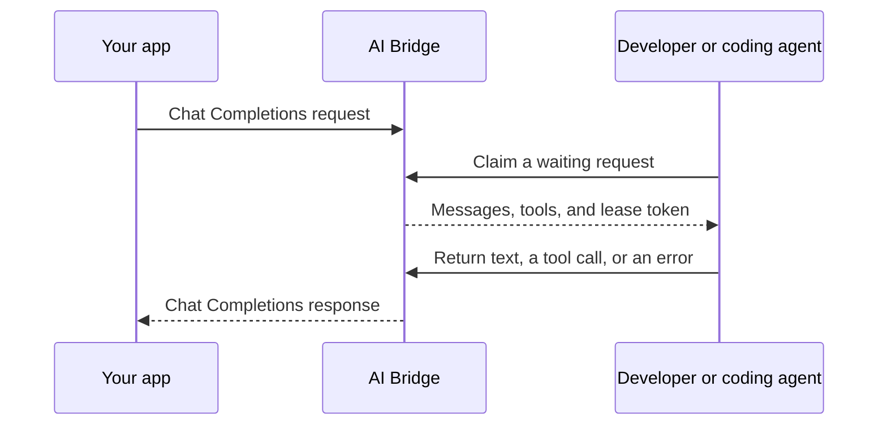

# AI Bridge

**Let a developer or coding agent answer your AI app's next model request.**

AI Bridge is a local OpenAI-compatible endpoint for debugging model calls.
Point your app at the bridge, inspect the exact messages and tools it sent,
then return the response you want the app to handle. Reproduce a missing tool
call, force an upstream error, or test a branch of your parser with a fixed
reply. The local demo runs without a provider API key.

[Quickstart](#try-it-locally) · [Agent protocol](docs/agent.md) ·
[Operations](docs/operations.md) · [Changelog](CHANGELOG.md) ·
[Русский](docs/ru.md)



## Try it locally

Use Python 3.10+ on a Unix-like system. This example sends a tool schema and
returns a tool call using the CLI.

```bash
git clone https://github.com/skywayapsny/ai-bridge.git
cd ai-bridge
python3 -m venv .venv
. .venv/bin/activate
python -m pip install .
AI_BRIDGE_MODELS=debug ai-bridge
```

In a second terminal, send a request. The call waits for an answer.

```bash
curl -sS http://127.0.0.1:8777/v1/chat/completions \
  -H 'Content-Type: application/json' -d @- <<'JSON'
{
  "model": "debug",
  "messages": [{"role": "user", "content": "Where is order A123?"}],
  "tools": [{
    "type": "function",
    "function": {
      "name": "lookup_order",
      "parameters": {
        "type": "object",
        "properties": {"order_id": {"type": "string"}},
        "required": ["order_id"]
      }
    }
  }]
}
JSON
```

In a third terminal, activate the same environment and inspect the request.

```bash
. .venv/bin/activate
ai-bridge-agent --client-id local-debug claim --model debug --wait 10
```

Copy the returned `request.id` and `lease_token`, then send a controlled
tool call back to the client.

```bash
ai-bridge-agent respond REQUEST_ID --token LEASE_TOKEN \
  --tool lookup_order --args '{"order_id":"A123"}'
```

The second terminal receives `choices[0].message.tool_calls` with
`lookup_order` and `finish_reason: "tool_calls"`. In a real app, this is
where the app dispatches the tool and sends the result in its next request.

## Connect your application

Set the Chat Completions base URL to `http://127.0.0.1:8777/v1` and use
`debug` as the model. If the SDK requires a key for an unauthenticated
loopback instance, use any placeholder. With authentication enabled, use the
bridge client key.

```python
from openai import OpenAI

client = OpenAI(
    base_url="http://127.0.0.1:8777/v1",
    api_key="local-demo",
    timeout=310,
    max_retries=0,
)
result = client.chat.completions.create(
    model="debug",
    messages=[{"role": "user", "content": "Reproduce the missing tool call."}],
)
print(result.choices[0].message)
```

AI Bridge provides `GET /v1/models` and `POST /v1/chat/completions`, with
one choice, text, function tool calls and optional usage metadata. With
`stream=true` it sends the completed answer as SSE after the consumer
finishes. The client executes any tools and sends their results in the next
request. Responses API, embeddings, audio endpoints and provider-specific
client APIs are outside this interface. [Chat Completions API reference](https://developers.openai.com/api/reference/resources/chat/subresources/completions/methods/create)

## Pick a consumer

| Consumer | When to use it |
| --- | --- |
| `ai-bridge-agent` or `/brain/*` | A developer or coding agent inspects real traffic, reserves it with a lease and responds. |
| `ai-bridge-worker` | Forward a tagged request to an OpenAI-compatible upstream API. |
| `ai-bridge-poll` | Inspect and manage a queue directly from the machine that owns it. |
| `ai-bridge-browser` | Experiment with a chat page through the local Aquarium/CDP adapter. Browser session access and page selectors make this a development option. |

A coding agent such as Devin, Claude Code or Codex can run the CLI or use
HTTP from its workspace. It can inspect your application code or logs when
its host grants access. AI Bridge handles the model traffic, and fixed local
responses require zero provider calls. Running an upstream model or an
external agent still uses its provider's quota.

Use a dedicated model tag for each consumer. Model tags route jobs inside a
trusted workspace. Use a separate bridge instance, queue directory and keys
for each trust boundary. The [agent guide](docs/agent.md) covers sessions and
tool calls. The [operations guide](docs/operations.md) covers auth, worker
configuration and deployment.

## Verify changes

```bash
python -m pip install -e '.[test]'
python -m unittest discover -s tests -v
```

The suite creates temporary queues and uses loopback servers. It requires no
model account or upstream credentials.

## License

Copyright © 2026 skywayapsny. [MIT License](LICENSE)
