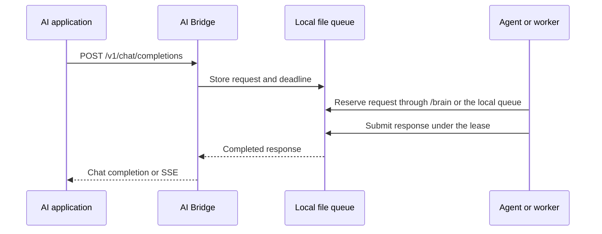

# Architecture and operations



A single bridge process accepts Chat Completions, manages the local
queue and converts the consumer's answer to the client protocol. Its worker
or coding agent can run as a separate process. HTTP consumers go through
`/brain/*` and supply a lease token on writes. Local workers share a
directory and coordinate transitions with a filesystem lock. Use a local
filesystem on one host. Each instance needs its own queue.

A request gets a deadline when it enters the queue. The client gets an answer
only while its HTTP call is alive. A server restart may leave queue files
until their deadlines or leases expire, but the original client connection
ends. Expired HTTP requests are swept at startup and periodically. Model
routing filters which consumer takes a request. A consumer with the agent key
can use the management API across all tags in that instance.

## Run an authenticated instance

Inject the two environment variables with your service supervisor or secret
store. Use different values for the app and agent roles.

```bash
umask 077
export AI_BRIDGE_QUEUE_DIR="$PWD/queue"
export AI_BRIDGE_MODELS=debug,upstream
ai-bridge --host 127.0.0.1 --port 8777 --timeout 300
```

| Environment variable | Scope and default |
| --- | --- |
| `AI_BRIDGE_API_KEY` | Bearer key for `/v1/*`. Empty allows local access. |
| `AI_BRIDGE_AGENT_KEY` | Bearer key for `/brain/*` and `/queue/*`. Falls back to the client key when empty. |
| `AI_BRIDGE_QUEUE_DIR` | Queue path. Defaults to the checkout's `queue/` when run from source, or `queue/` in the working directory of an installed command. |
| `AI_BRIDGE_HOST` / `AI_BRIDGE_PORT` | Defaults to `127.0.0.1:8777`. A non-loopback bind requires a client key. |
| `AI_BRIDGE_MODEL` / `AI_BRIDGE_MODELS` | Default tag `ai-bridge` and extra comma-separated tags advertised by `/v1/models`. |
| `AI_BRIDGE_TIMEOUT` | Client wait. Default 300 s. |
| `AI_BRIDGE_POLL_INTERVAL` | Queue check interval. Default 0.3 s. |
| `AI_BRIDGE_LEASE_SECONDS` | Default lease. Default 300 s. |
| `AI_BRIDGE_MAX_INFLIGHT` | Simultaneous Chat Completions requests per process. Default 32. |
| `AI_BRIDGE_REQUIRE_CLAIM` | `1` requires a lease for `/brain/respond`. `0` allows responses to unclaimed requests. |
| `AI_BRIDGE_LOG_LEVEL` | Uvicorn and app log level. Default `info`. |

The bridge reads its settings from the process environment. The worker
also reads a flat `KEY=VALUE` file via `--env-file`, with existing
environment variables taking precedence. Export the queue path before
starting either process. See [the environment sample](../.env.example).

For access from another machine, terminate TLS at a reverse proxy, set a
request-body limit, restrict ingress and set separate app and agent keys.
Allow app clients only the `/v1/*` paths and reserve `/brain/*` and
`/queue/*` for trusted operators. Proxy timeouts must exceed the
bridge wait for Chat Completions, and SSE routes need buffering disabled.
Use different bridge instances for different teams or workloads that
must not see each other's requests. The operational target is a
self-hosted, single-node bridge inside a trusted network.

Queue JSON holds the full messages, tool inputs, tool results and lease
tokens. Keep the directory writable only by its service account and use a
directory with permissions `0700`. Treat local `poll` access as
administrative. Agent claim files and application logs need the same
protection. Stop the bridge and its file workers together before upgrading
from 2.1 and resume them together against the same directory.

## Connect an upstream worker

```bash
export AI_WORKER_BASE_URL=https://provider.example/v1
export AI_WORKER_MODEL=provider-model
export AI_WORKER_CLAIM_MODEL=upstream
ai-bridge-worker --env-file /path/to/worker.env
```

Set `AI_WORKER_API_KEY` in the worker environment or the worker env file.
`AI_WORKER_API_KEYS` accepts a comma-separated list used in round robin.
`AI_WORKER_TIMEOUT` defaults to 60 s, `AI_WORKER_MAX_ATTEMPTS` to 3
and `AI_WORKER_WORKERS` to 1. A worker claims jobs only when it is ready
to process them. It retries transient upstream errors under the same lease
and returns an error to the app when it gives up. Align app, bridge and
worker timeouts with the time you want to spend on retries.

## Diagnose a stalled request

| Symptom | Check |
| --- | --- |
| `401` | The client key goes to `/v1/*` and the agent key goes to `/brain/*` and `/queue/*`. |
| `429` from the bridge | The instance reached its Chat Completions limit. |
| `502` | A consumer reported a failure. Check the consumer's logs and upstream connectivity. |
| `504` | No answer arrived by the bridge deadline. Check the request tag, agent availability and active leases. |
| SDK times out first | Increase the SDK or proxy timeout, or lower the bridge wait. |
| `/health` is OK but jobs wait | Health reports HTTP liveness. Check authenticated `/brain/stats`, `/queue/stats` or the consumer logs. |

Compare model calls per reproduction, elapsed time to diagnose the failure
and reported tokens when evaluating savings. Scripted responses exercise the
app without a provider request. Real agent and worker requests still depend on
provider usage and the amount of context sent.

## Optional browser adapter

The browser adapter talks to the local Aquarium/CDP process. Use a dedicated
Chromium profile and keep both control ports local. The CDP process can act
with access to that profile and its logged-in tabs. Adapter selectors depend
on the page, and automation depends on the provider's rules. The local mock
tests the adapter protocol independently of real accounts and sites.

From the source directory, start Aquarium with
`bash aquarium/start_aquarium.sh`. Then subscribe to a dedicated browser model
tag with `ai-bridge-browser --site SITE --model TAG --tab new`. Keep credentials
in the browser profile, and keep the profile out of the repository.
